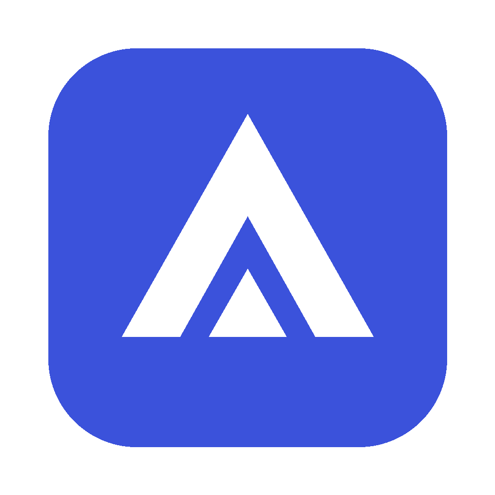

<p align="center">
  
</p>

<h1 align="center">OneYes Canvas · Infinite Canvas</h1>

<p align="center">
  <a href="README.md">简体中文</a> · <strong>English</strong> · <a href="README.zh-TW.md">繁體中文</a> · <a href="README.ja.md">日本語</a> · <a href="README.ko.md">한국어</a>
</p>

<p align="center">Connect ideas, media, AI generation, 3D previs and video editing on one canvas.</p>

<p align="center">
  <a href="https://github.com/Pan-chongyu/oneyes-infinite-canvas/releases/latest">Download</a> ·
  <a href="#features">Features</a> ·
  <a href="#get-started">Get started</a> ·
  <a href="#documentation">Documentation</a> ·
  <a href="https://github.com/Pan-chongyu/oneyes-infinite-canvas/issues">Report an issue</a>
</p>

OneYes Canvas is an open source desktop workspace for visual creators on Windows, macOS and Linux. Organize prompts, reference images and video storyboards with nodes and connections, move between AI generation and manual editing, and create together with people on the same local network.

<a id="features"></a>

## Features

| Workspace | What you can do |
| --- | --- |
| Infinite canvas | Manage projects, drag in media, zoom, navigate the minimap, group nodes, copy selections, connect nodes, undo and redo, and import or export projects. |
| Image creation | Generate images from text, edit with references, combine multiple image references, view streaming previews and retrieve asynchronous results. Refine prompts and compare iterations on the canvas. |
| Video creation | Generate from text, images or supported reference media. Choose the duration, aspect ratio and resolution supported by each model, and resume checking and retrieving tasks with saved receipts after restarting. |
| Generation settings | Connect text, images, video and audio to a settings node, reference media with @ mentions, and reuse workflows with model parameters and preferences for individual video models. |
| 3D Director | Generate sets and animated previs from prompts or connected references, then adjust characters, props, poses, lights and cameras. Edit shots and keyframes; export camera views, storyboard packages or PNG sequences. |
| Smart editing | Open a separate multitrack editor from a node. Trim, split, change speed, and add text, transitions and keyframes. Review AI editing drafts before applying them, then export the finished video back to the canvas. |
| Video to prompt | Extract reference frames and use a vision model to analyze scenes, action, camera movement and time segments. Edit the resulting detailed prompts and use them to build generation settings or storyboards. |
| Local creative tools | Remove backgrounds, composite layers, build collages and storyboards, grade and match colors, upscale images and videos with AI, analyze shots, join clips, and mix narration and music. |
| Scripts and comic videos | Use extension nodes to organize stories, characters and shots, connecting text, reference media and generation settings into a creative workflow. |
| Agent assistant | Connect Codex and Claude Code for sidebar conversations, execution status and approvals. Read and operate the current canvas through MCP, with one click to configure a persistent Codex connection. |
| LAN collaboration | Share a canvas with live member identities, cursors, selections and operation indicators. Synchronize edits and original media, reconnect automatically, and keep independent views. |
| Assets and extensions | Organize reusable images, video, audio and prompts. Configure WebDAV synchronization, drag in node plugins to install them, and develop your own nodes with the SDK. |

Model lists follow the permissions of the current API key. Supported media, dimensions and parameters vary by model and are shown in the interface. Animated 3D previs is for composition and shot planning; the selected AI model generates the actual video.

<a id="get-started"></a>

## Get started

1. **Install and connect:** Download the package for your OS and native chip architecture. Open Configuration and preferences, sign in to OneYes and configure models automatically, or enter keys manually. You can reuse an active OneYes Desktop session; Canvas also installs and works independently.
2. **Prepare content:** Create a canvas, drag in images, video or audio, add text and generation settings, and select reference media with connections or @ mentions.
3. **Generate and refine:** Choose a model, confirm its parameters and generate. Plan shots in 3D Director or refine the result in Smart editing. Generated results can become references for subsequent nodes.
4. **Save and share:** Keep projects and assets locally, export projects and finished work, configure WebDAV, or invite collaborators on the same local network.

After a connection loss or restart, tasks with reliable saved receipts continue querying the original task instead of automatically submitting another paid generation request. Submissions without a receipt retain a verification entry to help avoid duplicate calls.

<a id="downloads"></a>

## Downloads and updates

Visit [the latest release](https://github.com/Pan-chongyu/oneyes-infinite-canvas/releases/latest) and choose a package for your operating system and native chip architecture:

| System | Chip | Package |
| --- | --- | --- |
| Windows | x64 / ARM64 | EXE installer |
| macOS | Intel / Apple Silicon | DMG / ZIP |
| Linux | x64 / ARM64 | AppImage / DEB / RPM |

OTA updates are built in. The app checks and prepares updates in the background; version and download status appear at the top of the canvas. When ready, click to install and reopen the app. Updates include signature and full file verification, download progress and resumable downloads. Windows also supports block level updates and a separate update progress window. Releases include installer checksums.

<a id="data"></a>

## Data and synchronization

Canvases and media are stored on the current device by default. WebDAV synchronization is optional, and LAN collaboration synchronizes content directly between room members. Multitrack editing projects remain local; videos exported back to the canvas can be shared with it.

The desktop app encrypts keys and connection settings locally; browser development uses browser storage. AI calls send selected prompts and reference media to the configured endpoint. LAN collaboration does not share accounts or API keys with collaborators.

<a id="documentation"></a>

## Documentation

The detailed guides below are currently in Simplified Chinese.

- [OneYes connection, local storage and desktop builds](https://github.com/Pan-chongyu/oneyes-infinite-canvas/blob/codex/smart-video-edit/docs/ONEYES_DESKTOP.md)
- [Automatic model synchronization and configuration](https://github.com/Pan-chongyu/oneyes-infinite-canvas/blob/codex/smart-video-edit/docs/MODEL_SYNC.zh-CN.md)
- [3D Director: sets, animation, shots and export](https://github.com/Pan-chongyu/oneyes-infinite-canvas/blob/codex/smart-video-edit/docs/DIRECTOR.zh-CN.md)
- [Video to prompt and generation settings](https://github.com/Pan-chongyu/oneyes-infinite-canvas/blob/codex/smart-video-edit/docs/VIDEO_WORKFLOW.zh-CN.md)
- [Video requests and task recovery](https://github.com/Pan-chongyu/oneyes-infinite-canvas/blob/codex/smart-video-edit/docs/VIDEO_BRIDGE.zh-CN.md)
- [Smart editing](https://github.com/Pan-chongyu/oneyes-infinite-canvas/blob/codex/smart-video-edit/docs/SMART_EDIT.zh-CN.md)
- [LAN collaboration](https://github.com/Pan-chongyu/oneyes-infinite-canvas/blob/codex/smart-video-edit/docs/COLLABORATION.zh-CN.md)
- [Node plugin development](https://github.com/Pan-chongyu/oneyes-infinite-canvas/blob/codex/smart-video-edit/docs/content/docs/development/canvas-node-plugins.zh-CN.mdx)
- [Canvas shortcuts](https://github.com/Pan-chongyu/oneyes-infinite-canvas/blob/codex/smart-video-edit/docs/content/docs/canvas/canvas-shortcuts.mdx)
- [OTA updates](https://github.com/Pan-chongyu/oneyes-infinite-canvas/blob/codex/smart-video-edit/docs/OTA_POLICY.zh-CN.md)
- [Changelog](https://github.com/Pan-chongyu/oneyes-infinite-canvas/blob/codex/smart-video-edit/CHANGELOG.md)

<a id="development"></a>

## Local development

The maintained desktop source is on the `codex/smart-video-edit` branch:

```bash
git clone --branch codex/smart-video-edit https://github.com/Pan-chongyu/oneyes-infinite-canvas.git
cd oneyes-infinite-canvas
npm ci
npm ci --prefix web
npm ci --prefix canvas-agent
npm ci --prefix vendor/velocut/web --ignore-scripts
```

For browser development, run `npm --prefix web run dev`. Desktop packaging also requires preparing local media tools and building the app. See the [desktop build guide](https://github.com/Pan-chongyu/oneyes-infinite-canvas/blob/codex/smart-video-edit/docs/ONEYES_DESKTOP.md) for the full steps.

See [LICENSE](https://github.com/Pan-chongyu/oneyes-infinite-canvas/blob/codex/smart-video-edit/LICENSE) and [NOTICE](https://github.com/Pan-chongyu/oneyes-infinite-canvas/blob/codex/smart-video-edit/NOTICE.md) for licenses and third party acknowledgments.
