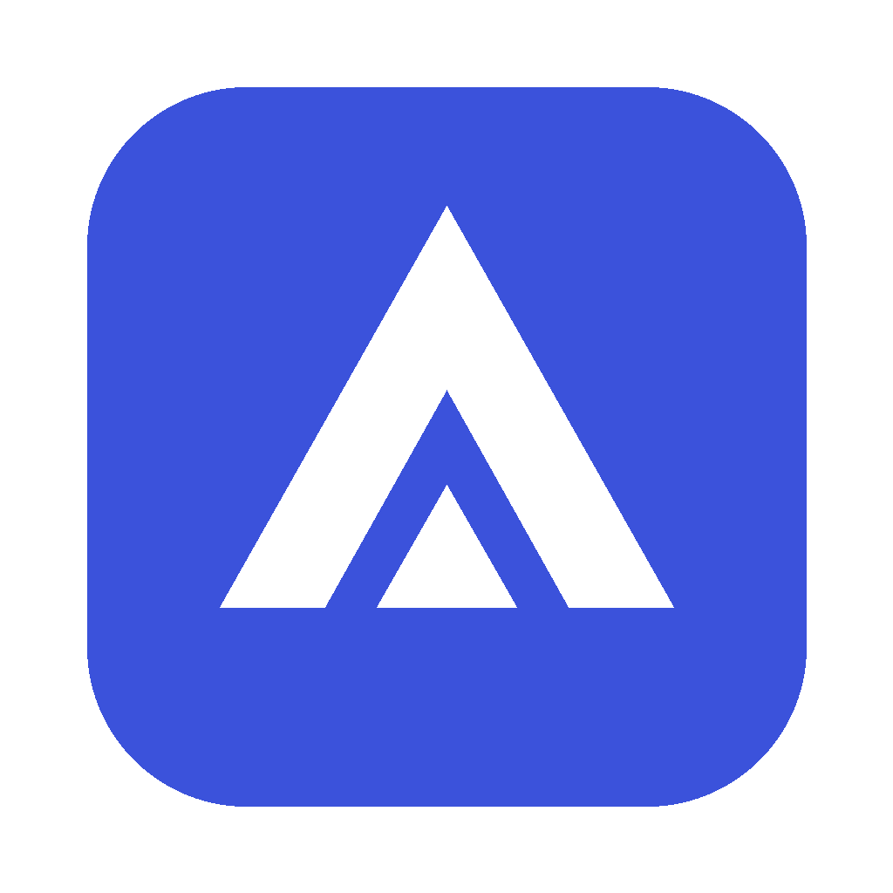

<p align="center">
  
</p>

<h1 align="center">OneYes Canvas · 無限キャンバス</h1>

<p align="center">
  <a href="README.md">简体中文</a> · <a href="README.en.md">English</a> · <a href="README.zh-TW.md">繁體中文</a> · <strong>日本語</strong> · <a href="README.ko.md">한국어</a>
</p>

<p align="center">アイデア、素材、AI 生成、3D プリビズ、動画編集をひとつのキャンバスに。</p>

<p align="center">
  <a href="https://github.com/Pan-chongyu/oneyes-infinite-canvas/releases/latest">ダウンロード</a> ·
  <a href="#features">主な機能</a> ·
  <a href="#get-started">はじめに</a> ·
  <a href="#documentation">ドキュメント</a> ·
  <a href="https://github.com/Pan-chongyu/oneyes-infinite-canvas/issues">問題を報告</a>
</p>

OneYes Canvas は、Windows、macOS、Linux に対応した、ビジュアル制作のためのオープンソースのデスクトップワークスペースです。プロンプト、参考画像、動画の絵コンテをノードと接続で整理し、AI 生成と手作業の編集をつなげられます。同じローカルネットワークのメンバーとの共同制作にも対応しています。

<a id="features"></a>

## 主な機能

| ワークスペース | できること |
| --- | --- |
| 無限キャンバス | 複数プロジェクトの管理、素材のドラッグ＆ドロップ、ズーム、ミニマップ、グループ化、一括コピー、ノード接続、元に戻す・やり直す、プロジェクトの入出力。 |
| 画像制作 | テキストからの画像生成、参考画像を使った編集、複数画像の参照、ストリーミングプレビュー、非同期結果の取得。キャンバス上でプロンプトを調整し、結果を比較して改善できます。 |
| 動画制作 | テキスト、画像、対応する参考素材から動画を生成。モデルごとに対応する長さ、縦横比、解像度を表示し、受付情報を保存したタスクは再起動後も状態確認と取得を続けられます。 |
| 生成設定 | テキスト、画像、動画、音声を設定ノードへ接続し、@ で素材を参照。モデルとパラメーター、動画モデル別の既定値を管理してワークフローを再利用できます。 |
| 3D ディレクター | プロンプトや接続した参考素材からセットと動くプリビズを作り、人物、小道具、ポーズ、照明、カメラを手動で調整。ショットとキーフレームを編集し、カメラ画像、絵コンテ一式、PNG 連番を書き出せます。 |
| スマート編集 | ノードから独立したマルチトラック編集ウィンドウを開き、トリミング、分割、速度変更、テキスト、トランジション、キーフレームを編集。AI の編集案を確認して適用し、完成動画をキャンバスに戻せます。 |
| 動画からプロンプトを作成 | 参考フレームを抽出し、視覚モデルで場面、動作、カメラワーク、時間区間を分析。詳細なプロンプトを編集し、生成設定や絵コンテに活用できます。 |
| ローカル制作ツール | 背景除去、レイヤー合成、コラージュと絵コンテ、カラー調整と色合わせ、画像・動画の AI アップスケール、ショット分析、動画結合、ナレーションと音楽のミックス。 |
| 脚本とコミック動画 | 拡張ノードでストーリー、キャラクター、ショットを整理し、テキスト、参考素材、生成設定を制作フローにつなげます。 |
| Agent アシスタント | Codex と Claude Code に接続し、サイドバーで会話、実行状況の確認、操作の承認が可能。MCP で現在のキャンバスを読み取り・操作し、ワンクリックで Codex の継続的な接続を設定できます。 |
| LAN 共同編集 | 同じキャンバスを共有し、メンバー、カーソル、選択ノード、操作状況をリアルタイム表示。編集と元の素材を同期し、切断時は自動再接続。各自の表示位置は独立しています。 |
| 素材と拡張 | 画像、動画、音声、プロンプトを再利用できる素材として管理。WebDAV 同期、ドラッグによるノードプラグインのインストール、SDK を使った独自ノード開発に対応。 |

モデル一覧は現在の API キーの権限に合わせて同期されます。対応する素材、サイズ、パラメーターはモデルごとに異なり、画面で確認できます。3D プリビズは構図やショットの設計用であり、実際の AI 動画は選択したモデルが生成します。

<a id="get-started"></a>

## はじめに

1. **インストールして接続**：OS と実際のチップ構成に合ったパッケージをダウンロード。「設定とユーザー設定」で OneYes にログインしてモデルを自動設定するか、キーを手動入力します。ログイン済みの OneYes Desktop のセッションも利用でき、Canvas 単体でのインストール、ログイン、利用も可能です。
2. **素材を用意**：キャンバスを作成して画像、動画、音声をドラッグし、テキストと生成設定を追加。接続や @ 参照で使用する素材を選びます。
3. **生成して調整**：モデルとパラメーターを確認して生成。3D ディレクターでショットを設計したり、スマート編集で動画を仕上げたりできます。生成結果は後続ノードの参考素材として利用できます。
4. **保存して共有**：プロジェクトと素材はローカルに保存されます。作品とプロジェクトの書き出し、WebDAV の設定、同じ LAN のメンバーとの共同編集が可能です。

切断や再起動の後も、確かな受付情報を保存したタスクは元のタスクを照会し、有料生成を自動で再送しません。受付情報が取得できなかった送信は確認用の入口を残し、重複呼び出しを防ぎます。

<a id="downloads"></a>

## ダウンロードと更新

[最新リリース](https://github.com/Pan-chongyu/oneyes-infinite-canvas/releases/latest)から、OS と実際のチップ構成に合うパッケージを選んでください。

| OS | チップ | パッケージ |
| --- | --- | --- |
| Windows | x64 / ARM64 | EXE インストーラー |
| macOS | Intel / Apple Silicon | DMG / ZIP |
| Linux | x64 / ARM64 | AppImage / DEB / RPM |

デスクトップ版には OTA 更新を内蔵しています。バックグラウンドで更新を確認・準備し、キャンバス上部にバージョンとダウンロード状況を表示します。準備ができたらクリックしてインストールし、アプリを再起動できます。署名とファイル全体の検証、進捗表示、中断したダウンロードの再開に対応。Windows ではブロック単位の差分更新と独立した進捗ウィンドウも利用できます。リリースにはインストーラーのチェックサムを同梱しています。

<a id="data"></a>

## データと同期

キャンバスと素材は標準で現在の端末に保存されます。WebDAV 同期は任意で、LAN 共同編集では参加端末間で直接内容を同期します。独立した編集ウィンドウのタイムラインはローカルに保存され、キャンバスに書き出した完成動画は共有できます。

デスクトップ版のキーと接続設定はローカルで暗号化して保存されます。ブラウザー開発版はブラウザーのローカルストレージを使用します。AI 呼び出しでは選択したプロンプトと参考素材を設定済みの API に送信します。LAN 共同編集でアカウントや API キーを他のメンバーへ共有することはありません。

<a id="documentation"></a>

## ドキュメント

以下の詳細ガイドは現在、簡体字中国語で提供しています。

- [OneYes 接続、データ保存、デスクトップビルド](https://github.com/Pan-chongyu/oneyes-infinite-canvas/blob/codex/smart-video-edit/docs/ONEYES_DESKTOP.md)
- [モデルの自動同期と設定](https://github.com/Pan-chongyu/oneyes-infinite-canvas/blob/codex/smart-video-edit/docs/MODEL_SYNC.zh-CN.md)
- [3D ディレクター：セット、アニメーション、ショット、書き出し](https://github.com/Pan-chongyu/oneyes-infinite-canvas/blob/codex/smart-video-edit/docs/DIRECTOR.zh-CN.md)
- [動画からのプロンプト作成と生成設定](https://github.com/Pan-chongyu/oneyes-infinite-canvas/blob/codex/smart-video-edit/docs/VIDEO_WORKFLOW.zh-CN.md)
- [動画リクエストとタスクの復元](https://github.com/Pan-chongyu/oneyes-infinite-canvas/blob/codex/smart-video-edit/docs/VIDEO_BRIDGE.zh-CN.md)
- [スマート編集](https://github.com/Pan-chongyu/oneyes-infinite-canvas/blob/codex/smart-video-edit/docs/SMART_EDIT.zh-CN.md)
- [LAN 共同編集](https://github.com/Pan-chongyu/oneyes-infinite-canvas/blob/codex/smart-video-edit/docs/COLLABORATION.zh-CN.md)
- [ノードプラグイン開発](https://github.com/Pan-chongyu/oneyes-infinite-canvas/blob/codex/smart-video-edit/docs/content/docs/development/canvas-node-plugins.zh-CN.mdx)
- [キャンバスのショートカット](https://github.com/Pan-chongyu/oneyes-infinite-canvas/blob/codex/smart-video-edit/docs/content/docs/canvas/canvas-shortcuts.mdx)
- [OTA 更新](https://github.com/Pan-chongyu/oneyes-infinite-canvas/blob/codex/smart-video-edit/docs/OTA_POLICY.zh-CN.md)
- [変更履歴](https://github.com/Pan-chongyu/oneyes-infinite-canvas/blob/codex/smart-video-edit/CHANGELOG.md)

<a id="development"></a>

## ローカル開発

デスクトップ版のメンテナンス対象コードは `codex/smart-video-edit` ブランチにあります。

```bash
git clone --branch codex/smart-video-edit https://github.com/Pan-chongyu/oneyes-infinite-canvas.git
cd oneyes-infinite-canvas
npm ci
npm ci --prefix web
npm ci --prefix canvas-agent
npm ci --prefix vendor/velocut/web --ignore-scripts
```

ブラウザー開発は `npm --prefix web run dev` で起動します。デスクトップのパッケージ作成には、ローカルのメディアツールの準備とアプリのビルドが必要です。詳しくは[ビルドガイド](https://github.com/Pan-chongyu/oneyes-infinite-canvas/blob/codex/smart-video-edit/docs/ONEYES_DESKTOP.md)を参照してください。

ライセンスと第三者コンポーネントのクレジットは [LICENSE](https://github.com/Pan-chongyu/oneyes-infinite-canvas/blob/codex/smart-video-edit/LICENSE) と [NOTICE](https://github.com/Pan-chongyu/oneyes-infinite-canvas/blob/codex/smart-video-edit/NOTICE.md)を参照してください。
