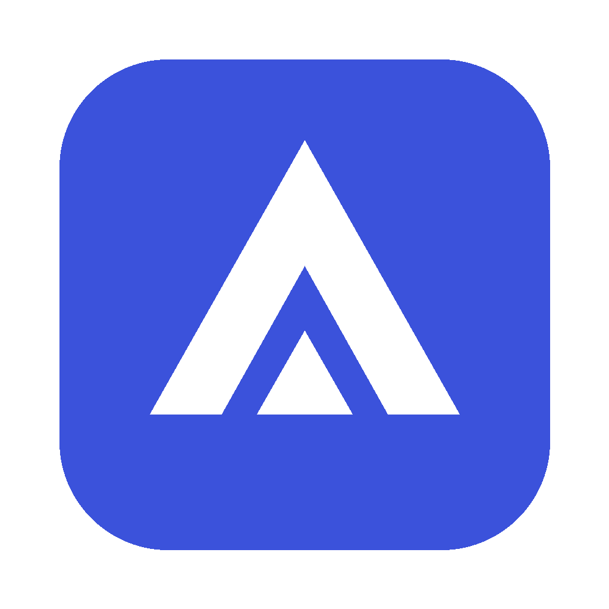

<p align="center">
  
</p>

<h1 align="center">OneYes Canvas · 무한 캔버스</h1>

<p align="center">
  <a href="README.md">简体中文</a> · <a href="README.en.md">English</a> · <a href="README.zh-TW.md">繁體中文</a> · <a href="README.ja.md">日本語</a> · <strong>한국어</strong>
</p>

<p align="center">아이디어, 미디어, AI 생성, 3D 프리비즈, 영상 편집을 하나의 캔버스에서 연결하세요.</p>

<p align="center">
  <a href="https://github.com/Pan-chongyu/oneyes-infinite-canvas/releases/latest">다운로드</a> ·
  <a href="#features">주요 기능</a> ·
  <a href="#get-started">시작하기</a> ·
  <a href="#documentation">문서</a> ·
  <a href="https://github.com/Pan-chongyu/oneyes-infinite-canvas/issues">문제 제보</a>
</p>

OneYes Canvas는 Windows, macOS, Linux를 지원하는 시각 창작용 오픈 소스 데스크톱 작업 공간입니다. 프롬프트, 참고 이미지, 영상 스토리보드를 노드와 연결선으로 정리하고 AI 생성과 수동 편집을 이어갈 수 있습니다. 같은 로컬 네트워크에 있는 동료와 함께 작업할 수도 있습니다.

<a id="features"></a>

## 주요 기능

| 작업 공간 | 할 수 있는 작업 |
| --- | --- |
| 무한 캔버스 | 여러 프로젝트 관리, 미디어 드래그, 확대·축소와 미니맵, 그룹, 일괄 복사, 노드 연결, 실행 취소·다시 실행, 프로젝트 가져오기와 내보내기. |
| 이미지 제작 | 텍스트로 이미지 생성, 참고 이미지 편집, 여러 이미지 참조, 스트리밍 미리 보기, 비동기 결과 가져오기. 캔버스에서 프롬프트를 다듬고 결과를 비교하며 개선할 수 있습니다. |
| 영상 제작 | 텍스트, 이미지와 지원되는 참고 미디어로 영상을 생성합니다. 모델별 길이, 화면 비율과 해상도를 표시하며, 접수 정보가 저장된 작업은 재시작 후에도 조회와 결과 가져오기를 계속합니다. |
| 생성 설정 | 텍스트, 이미지, 영상, 오디오를 설정 노드에 연결하고 @로 미디어를 참조합니다. 모델과 매개변수, 영상 모델별 기본 설정을 관리해 작업 흐름을 재사용합니다. |
| 3D 디렉터 | 프롬프트나 연결된 참고 자료로 세트와 움직이는 프리비즈를 만들고 인물, 소품, 자세, 조명, 카메라를 직접 조정합니다. 숏과 키프레임을 편집하고 카메라 이미지, 스토리보드 패키지 또는 PNG 시퀀스를 내보냅니다. |
| 스마트 편집 | 노드에서 독립된 멀티트랙 편집 창을 열어 다듬기, 분할, 속도 변경, 텍스트, 전환, 키프레임을 편집합니다. AI 편집 초안을 확인한 뒤 적용하고 완성 영상을 캔버스로 내보냅니다. |
| 영상에서 프롬프트 생성 | 참고 프레임을 추출하고 시각 모델로 장면, 동작, 카메라 움직임과 시간 구간을 분석합니다. 상세 프롬프트를 편집하고 생성 설정이나 스토리보드로 이어갈 수 있습니다. |
| 로컬 창작 도구 | 배경 제거, 레이어 합성, 콜라주와 스토리보드, 색 보정과 색상 맞추기, 이미지·영상 AI 업스케일링, 숏 분석, 영상 연결, 내레이션과 음악 믹싱. |
| 대본과 모션 코믹 | 확장 노드로 이야기, 캐릭터, 숏을 정리하고 텍스트, 참고 미디어와 생성 설정을 제작 흐름으로 연결합니다. |
| Agent 도우미 | Codex와 Claude Code를 연결해 사이드바에서 대화하고 실행 상태를 확인하며 작업을 승인합니다. MCP로 현재 캔버스를 읽고 조작하며, 한 번의 클릭으로 지속적인 Codex 연결을 설정합니다. |
| LAN 협업 | 같은 캔버스를 공유하며 참여자, 커서, 선택 노드, 작업 상태를 실시간으로 표시합니다. 편집과 원본 미디어를 동기화하고 자동으로 재연결하며 각자의 화면 위치는 독립적으로 유지합니다. |
| 미디어와 확장 | 이미지, 영상, 오디오, 프롬프트를 재사용 가능한 자료로 관리합니다. WebDAV 동기화, 드래그로 노드 플러그인 설치, SDK를 활용한 사용자 노드 개발을 지원합니다. |

모델 목록은 현재 API 키의 실제 권한에 따라 동기화됩니다. 지원 미디어, 크기와 매개변수는 모델마다 다르며 화면에서 확인할 수 있습니다. 3D 프리비즈는 구도와 숏 설계용이며 실제 AI 영상은 선택한 모델이 생성합니다.

<a id="get-started"></a>

## 시작하기

1. **설치 및 연결:** 운영체제와 실제 칩 아키텍처에 맞는 설치 파일을 받으세요. 구성 및 사용자 환경설정에서 OneYes에 로그인해 모델을 자동 설정하거나 키를 직접 입력합니다. 로그인된 OneYes Desktop 세션을 재사용할 수 있으며 Canvas만 독립적으로 설치하고 로그인해 사용할 수도 있습니다.
2. **콘텐츠 준비:** 캔버스를 만들고 이미지, 영상, 오디오를 드래그합니다. 텍스트와 생성 설정을 추가하고 연결선이나 @ 참조로 참고 자료를 선택합니다.
3. **생성 및 수정:** 모델과 매개변수를 확인한 뒤 생성합니다. 3D 디렉터에서 숏을 설계하거나 스마트 편집으로 영상을 다듬으세요. 생성 결과는 다음 노드의 참고 자료로 사용할 수 있습니다.
4. **저장 및 공유:** 프로젝트와 미디어는 로컬에 저장됩니다. 프로젝트와 작품을 내보내거나 WebDAV를 설정하고, 같은 LAN의 동료를 초대해 함께 편집하세요.

연결이 끊기거나 앱을 재시작해도 확실한 접수 정보가 저장된 작업은 원래 작업을 조회하며 유료 생성을 자동으로 다시 제출하지 않습니다. 접수 정보를 받지 못한 요청에는 확인 경로를 남겨 중복 호출을 방지합니다.

<a id="downloads"></a>

## 다운로드 및 업데이트

[최신 릴리스](https://github.com/Pan-chongyu/oneyes-infinite-canvas/releases/latest)에서 운영체제와 실제 칩 아키텍처에 맞는 설치 파일을 선택하세요.

| 시스템 | 칩 | 설치 파일 |
| --- | --- | --- |
| Windows | x64 / ARM64 | EXE 설치 프로그램 |
| macOS | Intel / Apple Silicon | DMG / ZIP |
| Linux | x64 / ARM64 | AppImage / DEB / RPM |

데스크톱 앱에는 OTA 업데이트가 내장되어 있습니다. 백그라운드에서 업데이트를 확인하고 준비하며 캔버스 상단에 버전과 다운로드 상태를 표시합니다. 준비가 끝나면 클릭해 설치하고 앱을 다시 열 수 있습니다. 서명과 전체 파일 검증, 다운로드 진행률, 이어받기를 지원합니다. Windows는 블록 단위 증분 업데이트와 별도 진행 창도 제공합니다. 릴리스에는 설치 파일 체크섬이 포함됩니다.

<a id="data"></a>

## 데이터 및 동기화

캔버스와 미디어는 기본적으로 현재 기기에 저장됩니다. WebDAV 동기화는 선택 사항이며 LAN 협업은 방에 참여한 기기끼리 직접 콘텐츠를 동기화합니다. 독립 편집 창의 타임라인 프로젝트는 로컬에 저장되고, 캔버스로 내보낸 완성 영상은 공유할 수 있습니다.

데스크톱 앱의 키와 연결 설정은 로컬에 암호화해 저장합니다. 브라우저 개발 버전은 브라우저 로컬 저장소를 사용합니다. AI 호출 시 선택한 프롬프트와 참고 자료가 설정한 API로 전송되며, LAN 협업은 계정과 API 키를 다른 참여자에게 공유하지 않습니다.

<a id="documentation"></a>

## 문서

아래 상세 가이드는 현재 중국어 간체로 제공됩니다.

- [OneYes 연결, 로컬 저장소와 데스크톱 빌드](https://github.com/Pan-chongyu/oneyes-infinite-canvas/blob/codex/smart-video-edit/docs/ONEYES_DESKTOP.md)
- [모델 자동 동기화 및 설정](https://github.com/Pan-chongyu/oneyes-infinite-canvas/blob/codex/smart-video-edit/docs/MODEL_SYNC.zh-CN.md)
- [3D 디렉터: 세트, 애니메이션, 숏과 내보내기](https://github.com/Pan-chongyu/oneyes-infinite-canvas/blob/codex/smart-video-edit/docs/DIRECTOR.zh-CN.md)
- [영상 프롬프트 분석 및 생성 설정](https://github.com/Pan-chongyu/oneyes-infinite-canvas/blob/codex/smart-video-edit/docs/VIDEO_WORKFLOW.zh-CN.md)
- [영상 요청 및 작업 복구](https://github.com/Pan-chongyu/oneyes-infinite-canvas/blob/codex/smart-video-edit/docs/VIDEO_BRIDGE.zh-CN.md)
- [스마트 편집](https://github.com/Pan-chongyu/oneyes-infinite-canvas/blob/codex/smart-video-edit/docs/SMART_EDIT.zh-CN.md)
- [LAN 협업](https://github.com/Pan-chongyu/oneyes-infinite-canvas/blob/codex/smart-video-edit/docs/COLLABORATION.zh-CN.md)
- [노드 플러그인 개발](https://github.com/Pan-chongyu/oneyes-infinite-canvas/blob/codex/smart-video-edit/docs/content/docs/development/canvas-node-plugins.zh-CN.mdx)
- [캔버스 단축키](https://github.com/Pan-chongyu/oneyes-infinite-canvas/blob/codex/smart-video-edit/docs/content/docs/canvas/canvas-shortcuts.mdx)
- [OTA 업데이트](https://github.com/Pan-chongyu/oneyes-infinite-canvas/blob/codex/smart-video-edit/docs/OTA_POLICY.zh-CN.md)
- [변경 내역](https://github.com/Pan-chongyu/oneyes-infinite-canvas/blob/codex/smart-video-edit/CHANGELOG.md)

<a id="development"></a>

## 로컬 개발

데스크톱 유지 관리 코드는 `codex/smart-video-edit` 브랜치에 있습니다.

```bash
git clone --branch codex/smart-video-edit https://github.com/Pan-chongyu/oneyes-infinite-canvas.git
cd oneyes-infinite-canvas
npm ci
npm ci --prefix web
npm ci --prefix canvas-agent
npm ci --prefix vendor/velocut/web --ignore-scripts
```

브라우저 개발은 `npm --prefix web run dev`로 시작합니다. 데스크톱 패키징에는 로컬 미디어 도구 준비와 앱 빌드가 필요합니다. 전체 절차는 [데스크톱 빌드 가이드](https://github.com/Pan-chongyu/oneyes-infinite-canvas/blob/codex/smart-video-edit/docs/ONEYES_DESKTOP.md)를 참고하세요.

라이선스와 타사 구성 요소의 출처는 [LICENSE](https://github.com/Pan-chongyu/oneyes-infinite-canvas/blob/codex/smart-video-edit/LICENSE) 및 [NOTICE](https://github.com/Pan-chongyu/oneyes-infinite-canvas/blob/codex/smart-video-edit/NOTICE.md)를 참고하세요.
